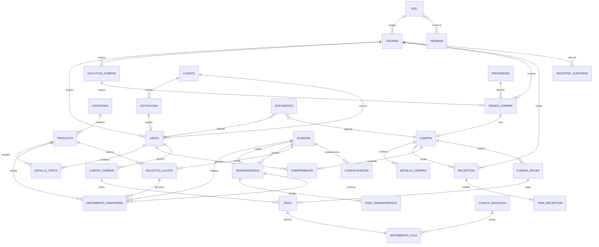

# Modelo de datos

## Relaciones

## Campos y obligatoriedad

`✓` significa obligatorio; `—` significa opcional. `ID`, `ISODate`, `ISODateOnly`, `Money` y demás alias están definidos en `src/types/common.ts`.

### Seguridad y maestros

| Entidad | Campos |
| --- | --- |
| `Usuario` | `id: ID ✓`, `nombres: string ✓`, `apellidos: string ✓`, `nombreUsuario: string ✓`, `email: string ✓`, `rolId: ID ✓`, `estado: EstadoRegistro ✓`, `ultimoAccesoEn: ISODate —`, campos de auditoría ✓ |
| `Rol` | `id: ID ✓`, `nombre: RolSistema ✓`, `descripcion: string ✓`, `permisoIds: ID[] ✓`, `estado: EstadoRegistro ✓`, campos de auditoría ✓ |
| `Permiso` | `id: ID ✓`, `recurso: RecursoSistema ✓`, `accion: AccionPermiso ✓`, `descripcion: string ✓`, campos de auditoría ✓. `ModuloSistema` solo agrupa navegación. |
| `Cliente` | `id`, `tipoDocumento`, `numeroDocumento`, `razonSocial`, `direccion`, `distrito`, `provincia`, `departamento`, `limiteCredito: Money`, `diasCredito: number`, `estado`: todos ✓; `nombreComercial`, `telefono`, `email` —; auditoría ✓ |
| `Proveedor` | `id`, `tipoDocumento`, `numeroDocumento`, `razonSocial`, `direccion`, `distrito`, `provincia`, `departamento`, `diasCredito: number`, `estado`: todos ✓; `nombreComercial`, `contactoNombre`, `telefono`, `email` —; auditoría ✓ |
| `Categoria` | `id: ID ✓`, `nombre: string ✓`, `descripcion: string —`, `categoriaPadreId: ID —`, `estado: EstadoRegistro ✓`, auditoría ✓ |
| `Producto` | `id`, `sku`, `nombre`, `categoriaId`, `unidadMedida`, `precioVenta: Money`, `costoReferencial: Money`, `tasaImpuesto: Decimal`, `stockMinimo: Decimal`, `estado`: todos ✓; `codigoBarras`, `descripcion` —; auditoría ✓ |
| `Almacen` | `id: ID ✓`, `codigo: string ✓`, `nombre: string ✓`, `direccion: string ✓`, `responsableUsuarioId: ID —`, `estado: EstadoRegistro ✓`, auditoría ✓ |

### Inventario y comercial

| Entidad | Campos |
| --- | --- |
| `StockPorAlmacen` | `productoId: ID ✓`, `almacenId: ID ✓`, `cantidad: Decimal ✓`, `valorCosto: Money ✓`, `ultimaActualizacionEn: ISODate —`; proyección no editable |
| `MovimientoInventario` | `id`, `tipo`, `productoId`, `almacenId`, `cantidad: Decimal`, `costoUnitario: Money`, `fecha: ISODate`, `referenciaTipo`, `referenciaId`: todos ✓; `transferenciaId`, `solicitudAjusteId`, `motivo` —; auditoría ✓ |
| `SolicitudAjusteInventario` | `id`, `productoId`, `almacenId`, `cantidadEsperada: Decimal`, `motivo`, `solicitadoPorUsuarioId`, `estado: EstadoSolicitudAjuste (Pendiente | Aprobada | Rechazada | Anulada)`: todos ✓; `aprobadoPorUsuarioId`, `aprobadoEn` —; auditoría ✓. No es stock ni movimiento hasta aprobarse. |
| `ItemCotizacion` | `id: ID ✓`, `productoId: ID ✓`, `descripcionProducto: string ✓`, `cantidad: Decimal ✓`, `precioUnitario: Money ✓`, `descuento: Money ✓`, `tasaImpuesto: Decimal ✓` |
| `Cotizacion` | `id`, `numero`, `clienteId`, `vendedorId`, `fecha: ISODateOnly`, `validezHasta: ISODateOnly`, `moneda: Moneda`, `estado`, `items: ItemCotizacion[]`: todos ✓; `observaciones` —; auditoría ✓ |
| `DetalleVenta` | `id`, `ventaId`, `productoId`, `descripcionProducto`, `cantidad`, `precioUnitario`, `descuento`, `tasaImpuesto`: todos ✓ |
| `Venta` | `id`, `numero`, `clienteId`, `vendedorId`, `almacenId`, `fecha: ISODateOnly`, `moneda`, `condicionPago`, `plazoCreditoDias`, `estado: EstadoVentaPersistido`, `detalleIds`: todos ✓; `cotizacionId`, `observaciones` —; auditoría ✓. `Cobrado` se deriva. |
| `Comprobante` | Unión discriminada `ComprobanteVenta | NotaCreditoVenta | ComprobanteCompra`: `id`, `tipo`, `serie`, `numero`, `fechaEmision`, `moneda`, `estado` y auditoría ✓; la nota de crédito exige `ventaId`, `clienteId` y `comprobanteRelacionadoId`. |

### Compras

| Entidad | Campos |
| --- | --- |
| `ItemSolicitudCompra` | `id: ID ✓`, `productoId: ID ✓`, `cantidadSolicitada: Decimal ✓`, `observacion: string —` |
| `SolicitudCompra` | `id`, `numero`, `solicitanteUsuarioId`, `almacenDestinoId`, `fecha`, `estado: EstadoSolicitudCompraPersistido`, `items: ItemSolicitudCompra[]`: todos ✓; `motivo` —; auditoría ✓. `Atendida` se deriva. |
| `ItemOrdenCompra` | `id: ID ✓`, `productoId: ID ✓`, `cantidad: Decimal ✓`, `costoUnitario: Money ✓` |
| `OrdenCompra` | `id`, `numero`, `proveedorId`, `compradorUsuarioId`, `almacenDestinoId`, `fecha`, `estado: EstadoOrdenCompraPersistido`, `items: ItemOrdenCompra[]`: todos ✓; `solicitudCompraId`, `fechaEntregaEsperada`, `observaciones` —; auditoría ✓. `Parcial` y `Atendida` se derivan. |
| `DetalleCompra` | `id`, `compraId`, `productoId`, `descripcionProducto`, `cantidad`, `costoUnitario`, `tasaImpuesto`: todos ✓ |
| `Compra` | `id`, `numero`, `ordenCompraId`, `proveedorId`, `almacenId`, `fecha`, `moneda`, `condicionPago`, `plazoCreditoDias`, `estado: EstadoCompraPersistido`, `detalleIds`: todos ✓; auditoría ✓. Se crea al emitir `OrdenCompra`; `Recibida` y `Pagada` se derivan. |
| `ItemRecepcion` | `id`, `recepcionId`, `productoId`, `cantidadRecibida: Decimal`, `costoUnitario: Money`: todos ✓ |
| `Recepcion` | `id`, `numero`, `compraId`, `almacenId`, `recibidoPorUsuarioId`, `fecha`, `itemIds`: todos ✓; `observaciones` —; auditoría ✓. `Pendiente`, `Parcial` y `Completa` se derivan de cantidades. |

### Inventario físico y finanzas

| Entidad | Campos |
| --- | --- |
| `ItemTransferencia` | `id: ID ✓`, `transferenciaId: ID ✓`, `productoId: ID ✓`, `cantidad: Decimal ✓`, `costoUnitario: Money ✓` |
| `Transferencia` | `id`, `numero`, `almacenOrigenId`, `almacenDestinoId`, `solicitanteUsuarioId`, `fecha`, `estado: EstadoTransferenciaPersistido`, `itemIds`: todos ✓; `observaciones` —; auditoría ✓. `Completada` se deriva de los movimientos. |
| `CuentaCobrar` | `id`, `clienteId`, `ventaId`, `comprobanteId`, `fechaEmision`, `fechaVencimiento`, `moneda`: todos ✓; auditoría ✓. Importe, saldo y estado (`Pendiente`, `Vencida`, `Pagada`) se derivan de documentos, fecha y pagos; no se guardan. |
| `CuentaPagar` | `id`, `proveedorId`, `compraId`, `comprobanteId`, `fechaEmision`, `fechaVencimiento`, `moneda`: todos ✓; auditoría ✓. Importe, saldo y estado (`Pendiente`, `Vencida`, `Pagada`) se derivan de documentos, fecha y pagos; no se guardan. |
| `Configuracion` | `id: ID ✓`, `igvPorDefecto: Decimal ✓` (por defecto 0.18), `series: Partial<Record<TipoComprobante, SerieComprobante>> ✓` donde `SerieComprobante = { serie: string; correlativo: number }`, `almacenPorDefectoId: ID ✓`, `datosEmpresa: DatosEmpresa ✓`, `estado: EstadoRegistro ✓`, auditoría ✓ |
| `CuentaBancaria` | `id`, `banco`, `nombre`, `numeroEnmascarado`, `moneda`, `estado`: todos ✓; auditoría ✓. El saldo se deriva de movimientos de caja. |
| `MovimientoCaja` | `id`, `tipo`, `fecha`, `moneda`, `monto: Money`, `metodoPago`, `referenciaTipo`, `referenciaId`: todos ✓; `cuentaBancariaId`, `descripcion` —; auditoría ✓ |
| `Pago` | Unión discriminada `PagoCobro | PagoProveedor`: `id`, `tipo`, `fecha`, `moneda`, `monto`, `metodoPago`, `movimientoCajaId`, `usuarioId`: todos ✓; la variante de cobro exige `cuentaCobrarId` y la de pago exige `cuentaPagarId`; `cuentaBancariaId`, `referenciaExterna` —; auditoría ✓ |
| `Documento` | `id`, `tipo`, `nombreArchivo`, `mimeType`, `tamanoBytes`, `entidadTipo`, `entidadId`, `urlSimulada`, `subidoPorUsuarioId`: todos ✓; auditoría ✓ |
| `RegistroAuditoria` | `id`, `fecha`, `usuarioId`, `accion`, `modulo`, `entidadTipo`, `entidadId`, `descripcion`: todos ✓; `estadoAnterior`, `estadoPosterior`, `datosAntes`, `datosDespues` — |

## Reglas de integridad

- Los importes de línea se calculan como `cantidad × precioUnitario − descuento`; el impuesto se calcula sobre la base definida por la línea. Subtotales y totales no se guardan en entidades.
- `StockDisponible(producto, almacén) = StockFísico − Reservado`, donde `Reservado` suma ventas `Aprobado` sin comprobante de venta. Ninguno de los dos valores se persiste como saldo editable.
- Un `MovimientoInventario` de transferencia siempre pertenece a una transferencia y conserva el mismo producto, cantidad y costo en la salida y entrada.
- Un ajuste aprobado tiene dirección en `tipo`: `Ajuste entrada` o `Ajuste salida`.
- Un `Pago` tiene un solo destino: cuenta por cobrar o cuenta por pagar, nunca ambos.
- Una cuenta por cobrar o pagar no guarda `saldo`: `saldo = importeDerivado − sumaDePagosAplicados`.
- Los estados de cuenta y la existencia de comprobantes son proyecciones que se recalculan y validan desde las relaciones.
- Los estados de recepción, orden, compra, transferencia y venta que dependan de recepciones, pagos o movimientos parciales se obtienen mediante selectores; no se duplican en las entidades.
